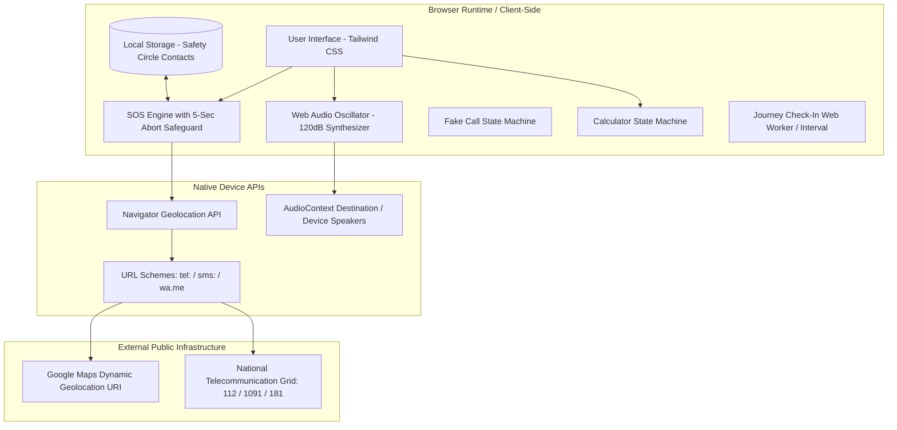

# Project Documentation: Abhaya (अभय) — Women's Safety & Campus Protection Platform
**Academic Project Report / Technical Submission for College Submission & Campus Website Integration**

---

## 1. Project Title & Abstract

- **Project Title:** Abhaya (अभय): Client-Side Intelligent Women Safety, Rapid Crisis Intervention & Legal Empowerment Web Portal
- **Domain:** Web Development, Public Safety Systems, Campus Security, Human-Computer Interaction (HCI)
- **Tagline:** *Zero-Gravity of Fear: Defying Fear, Living with Absolute Dignity*

### Abstract
Safety and mobility are fundamental human rights. In university campuses and urban/rural commuting environments, women frequently face situations ranging from harassment and stalking to life-threatening distress. **Abhaya** is an ultra-lightweight, zero-latency, privacy-preserving web application designed for instant crisis response, deceptive escape assistance, and legal/self-defense awareness. Built with pure client-side web technologies (HTML5, Tailwind CSS, Web Audio API, Geolocation API, LocalStorage), the platform operates without server delays or privacy breaches. In addition to high-decibel audio deterrents, automated WhatsApp/SMS GPS broadcasts, and fake call simulators, it features a discreet calculator camouflage mode that shields user intent from potential aggressors.

---

## 2. Problem Statement & Motivation

### The Challenges:
1. **Network Latency & Server Downtime:** Most commercial safety apps require cloud logins, user profiling, and internet connectivity, which fail in zero-balance or low-bandwidth emergency scenarios.
2. **Fear of Retaliation / Surveillance:** If an aggressor or suspicious cab driver sees a victim opening a police or safety app, aggression often escalates.
3. **Lack of Immediate Audible Deterrents:** Victims in deserted locations need an instant crowd attractor or auditory shock mechanism.
4. **Unawareness of Statutory Rights:** Students and citizens are often unaware of fundamental protections such as **Zero FIR**, **Section 46(4) CrPC (No arrest after sunset)**, and the **PoSH Act (Internal Complaints Committee on campus)**.

### The Solution:
A zero-install, zero-login, browser-native platform that functions instantaneously on mobile devices and desktops, disguised as everyday utilities when needed, and pre-configured with campus and national emergency protocols.

---

## 3. System Architecture & Technical Specifications

### Technical Stack:
- **Frontend Core:** HTML5, Modern ECMAScript (ES6+).
- **Styling Architecture:** Utility-first CSS via Google Antigravity Tailwind distribution (Zero CSS bundle bloat).
- **Audio Synthesis Engine:** Native browser `AudioContext` & `OscillatorNode` (no external MP3/WAV assets; zero bandwidth required).
- **Spatial Positioning:** `navigator.geolocation.getCurrentPosition` with high accuracy mode (`enableHighAccuracy: true`).
- **Data Persistence:** Client-side HTML5 `localStorage` (100% private, zero analytics, zero external logging).
- **Deep Linking URL Schemes:** `tel:`, `sms:?body=`, and WhatsApp API endpoint (`https://wa.me/?text=`).

---

## 4. Key Functional Modules

### 4.1. Rapid SOS Crisis Dispatcher (5-Second Safeguard)
- **Problem Solved:** Accidental clicks in panic situations or pockets.
- **Workflow:** Clicking "Activate SOS" triggers an animated 5-second countdown with an audible pulse.
- **Override Options:**
  - **Cancel (Safe):** Aborts without alerting.
  - **Send Now:** Immediately bypasses the timer.
- **Payload:** Fetches GPS latitude/longitude, formats a live Google Maps pinpoint (`https://maps.google.com/?q={lat},{lng}`), and opens pre-drafted SOS messages across SMS and WhatsApp to stored emergency contacts.

### 4.2. Sonic Deterrent Synthesizer (Siren & Whistle)
- **Problem Solved:** Physical whistles or sirens can be taken away or dropped.
- **Engineering:**
  - **Police Siren:** Uses a `sawtooth` oscillator sweeping dynamically between 700 Hz and 1300 Hz on an exponential ramp every 400ms.
  - **Whistle Blast:** Uses a high-gain `sine` wave ramping from 2600 Hz to 3200 Hz in staccato triplets (0.3s bursts).
- **Zero Assets:** Synthesized on the fly by the device's digital-to-analog converter (DAC).

### 4.3. Discreet Escape Fake Call Simulator
- **Problem Solved:** Provides a polite, non-confrontational exit excuse from an uncomfortable vehicle, date, or deserted area.
- **Presets:** *Papa (Dad)*, *Inspector Sharma (Police)*, *Bhaiya*, *Campus Warden*.
- **Timer Delays:** Instant, 5 seconds, or 15 seconds.
- **Audio Experience:** Generates a 440 Hz telephony ringtone followed by an on-screen dialog displaying realistic simulated voice responses.

### 4.4. Camouflage Calculator Mode (Anti-Snooping)
- **Problem Solved:** Conceals the app if someone leans over or forcefully inspects the user's phone.
- **Mechanism:** Instantly replaces the entire layout with a fully functional dark-mode arithmetic calculator.
- **Escape Gesture:** A secret double-click on the "Exit" control returns to the safety portal.

### 4.5. Journey Guardian (Transit Check-In Timer)
- **Problem Solved:** Solo night transit between college campus, library, coaching centers, or hostels.
- **Workflow:** User sets expected transit duration (e.g., 10 or 30 mins). If the user does not tap "I'm Safe" upon arrival, the portal triggers an alert chime and initiates the SOS dispatch protocol.

### 4.6. Safety Circle (Trusted Contact Manager)
- Local CRUD (Create, Read, Update, Delete) interface.
- Stores up to 5 primary contacts (Name, Relation, Phone) directly in the browser's persistent storage.

---

## 5. College Campus & Institutional Integration

For deployment on your college or university website (e.g. under `/safety` or `/womencell`), the following institutional contact points can be directly mapped into the portal:

| Campus Role | Designation / Desk | Suggested Integration |
| :--- | :--- | :--- |
| **Chief Proctor / Security Officer** | Main Campus Gate Control | One-tap direct dial |
| **Girls Hostel Warden** | Hostels 1, 2, 3 Emergency Desks | Speed dial & curfew check-in |
| **Internal Complaints Committee (ICC)** | PoSH Act 2013 Statutory Desk | Confidential complaint email portal |
| **Campus Health Center / Ambulance** | 24/7 Medical & Trauma Unit | One-tap emergency dispatch |
| **Local Police Station Precinct** | Nearest Thana Jurisdiction | Direct landline & Beat Officer cell |

---

## 6. Legal & Constitutional Rights Vault (India)

A key educational component of the website is the Rights Vault, educating students about statutory protections:
1. **Zero FIR:** As per Supreme Court directives, any police station in India must register an FIR irrespective of whether the crime occurred within their jurisdiction.
2. **Exemption from Night Arrest (CrPC Section 46(4)):** No woman can be arrested after sunset and before sunrise except under exceptional circumstances with judicial magistrate approval and female officer presence.
3. **Right to Complete Privacy (IPC Section 228A):** Mandatory protection of identity and privacy for victims of sexual harassment/violence.
4. **PoSH Act 2013:** Mandates that every educational institution and organization with 10+ members maintain an active Internal Complaints Committee (ICC).
5. **Free Medical Aid (CrPC Section 357C):** Mandates all hospitals (public or private) to provide immediate free first aid and medical care to survivors.

---

## 7. Thematic Philosophy & Ghibli Art Concept

- **Artwork Concept:** A 75-year-old grandmother floating weightlessly in a village hut, smiling serenely surrounded by floating utensils, glowing diyas, and golden hour fields.
- **Metaphor:** Gravity pulls heavy objects down; fear pulls human potential down. The zero-gravity scene represents **absolute freedom from fear (अभय)**. When protection and community safety are assured, every woman can navigate life weightlessly and fearlessly.

---

## 8. Viva Voce / Presentation Q&A Preparation

**Q1: Why did you build this as a web application instead of an Android/iOS native app?**
> *Answer:* Native apps require app store downloads, permissions approvals, device storage, and regular updates. In an emergency, a web application opens in under 1 second from a bookmark or QR code on any device (Android, iOS, PC, tablet) without installation friction.

**Q2: What happens if there is no internet connection?**
> *Answer:* The Web Audio siren, whistle, calculator camouflage, legal vault, and local contact dialer work 100% offline. Emergency phone calls (`tel:112`) connect via regular cellular GSM networks without mobile data.

**Q3: How does the application ensure user privacy and data security?**
> *Answer:* Zero tracking or telemetry. Contacts and preferences are saved exclusively in browser `localStorage`. No location coordinates or user data are ever uploaded to any third-party server.

---

## 9. Future Enhancements & Roadmap

1. **Progressive Web App (PWA):** Service worker caching for full offline home-screen icon installation.
2. **IoT Hardware Trigger:** Bluetooth Low Energy (BLE) smart ring or pendant trigger.
3. **Campus Geofencing:** Automatic hostel check-in notifications upon entering the university Wi-Fi perimeter.
