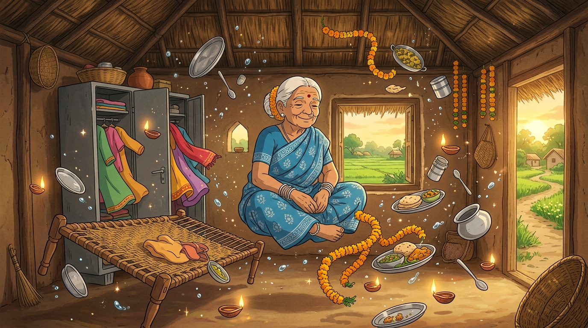

# Abhaya (अभय) — Women's Safety & Empowerment Platform
*Zero-Gravity of Fear: Defying Fear, Living with Absolute Dignity & Peace*



---

## 📖 Overview

**Abhaya (अभय)** is an all-in-one, responsive, privacy-first Women's Safety web platform designed for immediate crisis intervention, discrete situation exit, and legal/self-defense empowerment. 

Inspired by the Studio Ghibli artwork of a serene Indian grandmother floating in zero-gravity inside her village hut, the platform embodies the philosophy that fear should hold no weight in any woman's life.

---

## 📁 Folder Structure

All project files are fully self-contained inside this single directory:

```
raksha-women-safety/
├── index.html               # Main interactive web application
├── ghibli_grandmother.jpg   # Studio Ghibli anti-gravity artwork
└── README.md                # Project documentation & safety manual
```

---

## ⚡ Core Features & Capabilities

### 1. 🚨 Instant Emergency SOS Countdown
- **5-Second Safeguard Countdown**: Allows cancelling accidental taps while offering an instant "Send Now" override.
- **Live GPS Tracking**: Integrates browser Geolocation to fetch real-time latitude & longitude.
- **One-Tap WhatsApp & SMS Broadcast**: Sends pre-formatted emergency coordinates with live Google Maps links directly to saved contacts.

### 2. 🔊 Web Audio Deterrent Suite
- **Police Siren**: High-decibel alternating frequency sweep (700 Hz - 1300 Hz) using native Web Audio API oscillators.
- **Whistle Blasts**: Piercing staccato frequency bursts (2600 Hz - 3200 Hz).
- *Zero external sound files needed — works 100% offline.*

### 3. 📞 Fake Call Escape Simulator
- Simulates a realistic incoming call to help exit uncomfortable taxis, dates, or street encounters.
- Presets: *Papa (Dad)*, *Inspector Sharma (Police)*, *Bhaiya*, or *Cab Fleet Support*.
- Timer delays: *Instant*, *5 seconds*, or *15 seconds*.
- Synthesized ringtone + realistic Hindi/English voice script on answer.

### 4. 🛡️ Discreet Camouflage Mode (Working Calculator)
- One-click transformation of the interface into a realistic, functional math calculator (`7 × 8 = 56`).
- Secret double-tap escape toggle to switch back safely.

### 5. ⏱️ Journey Guardian (Travel Timer)
- Set countdown for auto rides, cab transit, or night walks (e.g., 10 minutes).
- Audible & visual safety check-in prompt upon arrival.
- Automatic emergency SOS alert triggered if safety confirmation is missed.

### 6. 🤝 Safety Circle (Local Storage Contacts)
- Add up to 5 emergency contacts with names, relations, and phone numbers.
- **100% Private**: Stored only in device `localStorage`. No data is uploaded to any remote server.

### 7. 🌐 Bilingual Support
- Instant switch between **English** and **हिन्दी** for accessibility across rural and urban communities.

---

## ☎️ Verified Indian Emergency Helplines

| Helpline | Purpose | Coverage |
| :--- | :--- | :--- |
| **112** | **National Emergency Number** | All-in-One: Police, Fire, Medical (Works without SIM/balance) |
| **1091** | **Women Helpline** | Immediate police distress assistance |
| **1090** | **Women Power Line (WPL)** | Dedicated anti-stalking, harassment & cyber crime line |
| **181** | **Women in Distress** | 24/7 domestic violence counseling, shelter & legal aid |
| **1098** | **Childline** | Minor protection & runaway support |
| **1930** | **National Cyber Crime** | Cyber harassment, blackmail & financial fraud |
| **+91 72177 35372**| **NCW WhatsApp Line** | National Commission for Women rapid response channel |

---

## ⚖️ Essential Legal Rights (India)

1. **Zero FIR**: You can register an FIR at **any police station** in India regardless of jurisdiction.
2. **Sunset to Sunrise Arrest Protection (Sec. 46(4) CrPC)**: Women cannot be arrested after sunset and before sunrise except with special magistrate order and female officer.
3. **Right to Complete Privacy (Sec. 228A IPC)**: Identity disclosure of sexual offense survivors is strictly prohibited.
4. **Virtual / Email Complaints**: Police complaints can be submitted via registered email or speed post to the Commissioner or SP.
5. **PoSH Act**: Mandatory Internal Complaints Committee (ICC) in every organization with 10+ employees.
6. **Free Medical Aid (Sec. 357C CrPC)**: All hospitals (government & private) must provide immediate free first aid and medical treatment.

---

## 🚀 How to Run

1. Open `index.html` directly in any modern web browser (Chrome, Edge, Firefox, Safari).
2. No build tools or Node.js server required.
3. To set as your active workspace in Antigravity, select this folder:
   `C:\Users\rohit\.gemini\antigravity\scratch\raksha-women-safety`
